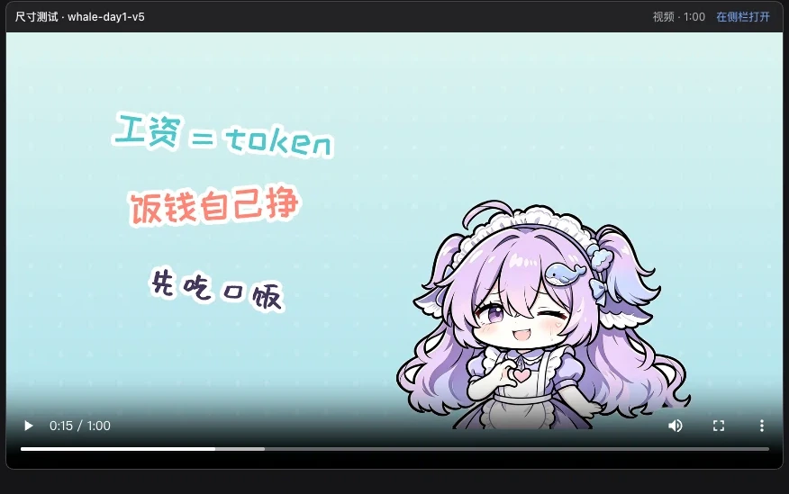

# dsh-media-tab

[](https://github.com/Moosphan/dsh-media-tab/actions/workflows/test.yml)
[](LICENSE)
[](#requirements)
[](CHANGELOG.md)

**Play local video and audio directly inside DeepSeek Harness.**
Inline player under the reply · dedicated sidebar player · recently-played list · zero runtime dependencies · no ffmpeg

[简体中文](README.md) | **English**



*Inline player under the reply: full-width, native controls, seeking, fullscreen and picture-in-picture.*

## Contents

- [Why](#why)
- [Features](#features)
- [Requirements](#requirements)
- [Install](#install)
- [Quick start](#quick-start)
- [Usage](#usage)
- [Supported formats](#supported-formats)
- [How it works](#how-it-works)
- [Security and privacy](#security-and-privacy)
- [Data and configuration](#data-and-configuration)
- [Troubleshooting](#troubleshooting)
- [FAQ](#faq)
- [Development](#development)
- [Roadmap](#roadmap)
- [Contributing](#contributing)
- [Acknowledgements](#acknowledgements)
- [License](#license)

## Why

DSH 0.2.1-rc.3 renders only `text / image / file / table` message blocks; the client bundles contain no `<video>` or `<audio>` element, and the sidebar document preview registers only Markdown, code, images, PDF, Office, HTML and plain text. When an agent delivers an mp4 through `present`:

- clicking the delivery card opens the sidebar and reports “cannot preview”
- the card’s open action launches the system player (QuickTime / IINA / VLC)

`dsh-media-tab` adds exactly three things:

1. **Inline playback** — media delivered in the current turn appears under the reply automatically
2. **Sidebar player** — clicking a delivery card or file link turns the right-sidebar preview into a player
3. **Recently played** — the last 20 played files, newest first, one click to switch

It is deliberately **not** a media library and **not** a transcoder: no favourites, search, tags, playlists, HLS or remote URLs.

## Features

| Capability | Detail |
|---|---|
| **Inline playback** | Media delivered with `present` renders under the reply; folds after three files |
| **Sidebar player** | Takes over `documentPreviews`, so media no longer falls into “cannot preview” |
| **Recently played** | 20 entries, newest first, missing files marked, clear action; shared by desktop and web |
| **Native controls** | Play, seek, volume, speed, fullscreen and picture-in-picture come from the browser |
| **HTTP Range** | 200 / 206 / 416 / HEAD; large files are streamed, never buffered whole |
| **Desktop seeking** | Signed absolute URLs load directly from the host origin, bypassing the `dsh-app://` forwarder that drops `Content-Length` |
| **Single instance** | Starting a new player pauses the others |
| **Error diagnostics** | Missing file, permission, unsupported codec and unreachable route each get their own message |
| **Zero dependencies** | No `@deepseek-ai/*` runtime imports, no bundled binaries |
| **Secure defaults** | Extension whitelist, `realpath`, host/origin fence, HMAC signing, `0600` secret |

## Requirements

- DSH `>=0.2.0-rc.1 <0.4.0-0` (tested end-to-end on **0.2.1-rc.3 desktop**: inline, sidebar, audio and recent list)
- Desktop or web client
- **No ffmpeg** and no extra Node runtime
- Node 22+ only for development and tests

## Install

### From GitHub

```sh
dsh plugin add github:Moosphan/dsh-media-tab
```

### From npm (after publishing)

```sh
dsh plugin add dsh-media-tab
```

### Local development

```sh
dsh plugin --profile desktop add link:/absolute/path/to/dsh-media-tab
```

**Restart DSH** after installing: host routes register at startup. After that, client changes need a page refresh; host changes still need a restart.

### Verify

```sh
curl -s http://127.0.0.1:<port>/dsh-media-tab/api/health
# {"ok":true,"name":"dsh-media-tab","version":"0.1.0"}
```

The Plugins page should list **Media Player**.

## Quick start

1. Deliver a local video:

   ```text
   present({ files: [{ path: "/Users/me/Movies/demo.mp4" }] })
   ```

2. The player appears under the reply.
3. Click **Open in sidebar** (or the delivery card) for the full-size player.
4. The **Recently played** list at the bottom of that page lets you switch files.

You can also say “play /path/a.mp4” and the model will call `play_media`.

## Usage

### present (recommended)

Media delivered with the built-in `present` tool gets a player automatically. The plugin appends the same `deliverables/presented` event as the official tool, so the delivery card and the sidebar open the same file.

### play_media

| Parameter | Required | Meaning |
|---|---|---|
| `path` | yes | Local path; `~` and session-relative paths are accepted |
| `title` | no | Player title, defaults to the file name |
| `autoplay` | no | Ask for autoplay (browsers usually block it) |
| `loop` | no | Loop playback |

The result carries a signed absolute URL that can be opened directly in a browser.

### Sidebar player

- Click a delivery card, or **Open in sidebar** on the inline player
- The recently-played list sits at the bottom and switches the current player in place

### Removal

- Player: pause it, or close the tab
- Plugin: Plugins → installed plugins → uninstall, then restart DSH

## Supported formats

Playback is limited by Chromium’s decoders:

| Category | Formats |
|---|---|
| Video | `.mp4` `.m4v` `.mov` `.webm` `.ogv` `.mkv` `.3gp` |
| Audio | `.mp3` `.wav` `.ogg` `.oga` `.m4a` `.aac` `.flac` `.opus` `.weba` |
| Depends on codec | `.mkv`, `.3gp`, HEVC `.mov`: platform-dependent (macOS / Windows have platform decoders, Linux may not) |
| Unsupported | `.avi` `.flv` `.wmv` `.wma` `.ts` `.mpg` `.mpeg` `.rm` `.rmvb` `.amr` `.ape` `.ac3` `.dts` `.mid` |

Unsupported containers get a copyable command instead of a black frame:

```sh
# video
ffmpeg -i in.avi -c:v libx264 -c:a aac -movflags +faststart out.mp4
# audio
ffmpeg -i in.wma -c:a aac out.m4a
```

The plugin itself has **no ffmpeg dependency** and never transcodes.

## How it works

### Mount points

| Surface | DSH mount point | Data |
|---|---|---|
| Under the reply | `conversation.chat.turnTail` | `turn.data.get('deliverables').presented` |
| Sidebar player | `documentPreviews` renderer + `sidebar.right.tab.document` | File address (delivery card / file link / recent list) |
| Tool link | `play_media` result | Signed absolute URL |

### Request flow

```text
present / play_media
        │
        └─ deliverables/presented ──► turnTail ──┐
                                                  │
delivery card / file link ──► documentPreviews ───┼──► MediaPlayer
                                                  │        │
recently played ──────────────────────────────────┘        │ GET /api/sign (login cookie)
                                                           ▼
                                              absolute + HMAC-signed URL
                                                           │ <video src>
                                                           ▼
                                     /dsh-media-tab/media?t=…  ── Range ──► disk
```

### Why the media URL is absolute

The desktop page loads from `dsh-app://app`; ordinary requests are forwarded to the local HTTP server by Electron. `forwardWebRequest` strips `Content-Length` from every response, so a 206 response has no length, Chromium treats the media as an unbounded stream, and seeking is disabled — the progress bar does nothing and paused scrubbing does not update the frame.

The player therefore asks `/api/sign` for an **absolute** URL and loads `<video>` straight from `http://127.0.0.1:<port>`, preserving `Content-Length` / `Content-Range`.

### Routes

| Route | Authorization | Purpose |
|---|---|---|
| `GET /dsh-media-tab/api/health` | Host fence | Readiness probe |
| `GET /dsh-media-tab/api/sign?p=` | Login cookie + fence | Mint the absolute signed URL |
| `GET/HEAD /dsh-media-tab/media?p=&t=` | **HMAC signature** | Range streaming |
| `GET/HEAD /dsh-media-tab/preview?p=` | Login cookie + fence | Diagnostics / compatibility |
| `GET/POST /dsh-media-tab/api/recent` | Login cookie + fence | Read / record the recent list |
| `POST /dsh-media-tab/api/recent/clear` | Login cookie + fence | Clear the recent list |

## Security and privacy

The DSH web server has no authentication of its own, so the plugin fences itself:

- **Media only** — extension whitelist; symlinks are resolved with `realpath`; directories, text files and arbitrary paths return 403
- **DNS-rebinding and cross-site fence** — the Host must be loopback or DSH’s own host; `Sec-Fetch-Site: cross-site` is rejected; a present `Origin` must match the Host
- **Two authorization paths**:
  - `/preview`, `/api/sign`, `/api/recent*` go through DSH’s `connection` service (login cookie); older hosts without it are loopback-only
  - `/media` accepts only an HMAC-SHA256 signature (32 hex chars); the secret lives at `~/.dsh/cache/dsh-media-tab/secret` with mode `0600`
- **Explicit cross-origin media** — `Access-Control-Allow-Origin: *` and `Cross-Origin-Resource-Policy: cross-origin` exist only so the `dsh-app://` page can load a signed URL; without a signature no bytes are served
- **Streaming** — `fs.createReadStream` reads only the requested range; a disk error ends that response, never the host
- **No network, no telemetry, no directory scanning**

Report security issues privately via [SECURITY.md](SECURITY.md).

## Data and configuration

| Item | Location |
|---|---|
| Recently played | `$DSH_HOME/cache/dsh-media-tab/recent.json` |
| Signing secret | `$DSH_HOME/cache/dsh-media-tab/secret` |

`DSH_HOME` defaults to `~/.dsh`. The recent file looks like:

```json
{
  "v": 1,
  "items": [
    {
      "path": "/Users/me/Movies/demo.mp4",
      "title": "demo.mp4",
      "kind": "video",
      "size": 29312618,
      "duration": 60.4,
      "position": 12.3,
      "plays": 2,
      "lastPlayedAt": 1761000000000
    }
  ]
}
```

Writes are atomic (temp file + rename); corrupt JSON is renamed aside instead of retried forever. Delete the two files to reset.

## Troubleshooting

| Symptom | Cause | Fix |
|---|---|---|
| Seek bar does nothing / paused scrubbing does not change the frame | Host still runs old code, or the client still uses a relative URL | Quit DSH completely and reopen; the media request should be `http://127.0.0.1:<port>/dsh-media-tab/media` |
| “Cannot reach the playback service” | Host route not mounted / plugin not loaded | Restart DSH; `curl /api/health` should return `{"ok":true}` |
| “File is gone” | File moved or deleted | Deliver the new path |
| “No permission to read this file” | macOS TCC / file mode | Grant DSH access, or pick a readable path |
| “Decode failed” | Codec not supported by Chromium | Convert with the `ffmpeg` command above |
| No “Media Player” card on the Plugins page | Bundle not selected / no restart | Enable it, then quit and reopen DSH |
| Black bars above/below the video | Portrait or non-16:9 source | Expected; `object-fit: contain` avoids cropping |

## FAQ

**Why is seeking broken?**
The desktop shell’s `dsh-app://` forwarder drops `Content-Length`, which disables Range seeking. Since 0.1.0 the player signs an absolute URL and loads media directly from the host origin. Make sure the host was restarted and the Network request is `http://127.0.0.1...`.

**Why are there black bars?**
`object-fit: contain` preserves the source aspect ratio. Inline players fill the column width; portrait videos are capped at `85vh`.

**Subtitles?**
Not yet; VTT/SRT are on the roadmap.

**Are my files uploaded?**
No. The plugin makes no outbound network requests; media is read from the local host route only.

**Can I disable the recent list?**
Not separately today. You can clear it; entries are local-only.

**How does this relate to `present`?**
`present` delivers files, this plugin plays them. `play_media` is just a convenience entry that appends the same `deliverables/presented` event.

## Development

```sh
npm test          # node --test: 39 cases
npm pack --dry-run
```

| File | Responsibility |
|---|---|
| `lib/index.js` | Host: route registration, `play_media`, `deliverables/presented` bridge |
| `lib/server.js` | Range, HMAC, authorization, fence, signing API, streaming |
| `lib/recent.js` | Recent store: atomic writes, LRU, dedupe, missing-file marking |
| `lib/client.js` | Browser half: inline player, sidebar page, recent list, signed-URL cache |
| `cordis.patch.yml` | Bundle mount declaration |

Tests cover Range (200/206/416/HEAD), signing and authorization failures, the cross-site fence, `/api/sign`, recent-store LRU/dedupe/corruption/concurrency, manifest consistency and a client component smoke render.

### Release checklist

1. `npm test`
2. Run the manual QA below on a real DSH
3. `npm publish --access public`
4. GitHub Release with the `npm pack` artifact
5. Update `CHANGELOG.md`

### Manual QA

1. `link:` install, restart, confirm the **Media Player** card
2. `present` an mp4 → player under the reply, full width, seeking works
3. Open the delivery card → sidebar player
4. Play it → the recent list shows the file; click to switch
5. Play an `.avi` → error card with the `ffmpeg` command
6. Pause, then scrub → the frame follows
7. DevTools → Network: media request is `206 Partial Content` at `http://127.0.0.1:<port>/dsh-media-tab/media...`

## Roadmap

- [ ] Subtitle tracks (native VTT / SRT conversion)
- [ ] Resume position
- [ ] Audio waveform (optional, generated on demand)
- [ ] Optional ffmpeg transcoding (only when detected, never bundled)
- [ ] A standalone “Recently played” sidebar entry
- [ ] Playlists / HLS

## Contributing

- Bug reports: DSH version, plugin version, OS, steps, and any `[dsh-media-tab]` console lines
- PRs: keep zero runtime dependencies and run `npm test`
- Security: private report per [SECURITY.md](SECURITY.md)
- New formats or behaviours: open an issue first so the scope is agreed

## Acknowledgements

- DSH plugin API and the `present` delivery channel: DeepSeek Harness docs and the `@deepseek-ai/dsh-*` packages
- Prior art: [`@orderg-x/dsh-video-preview`](https://github.com/OrderG-X/dsh-video-preview), [`dsh-media-inline-preview`](https://github.com/seeingrain/dsh-media-inline-preview), [`dsh-preview-media`](https://www.npmjs.com/package/dsh-preview-media)
- Design choices: no DOM fence scanning, no third-party runtime, media only from the host route

## License

[MIT](LICENSE)
